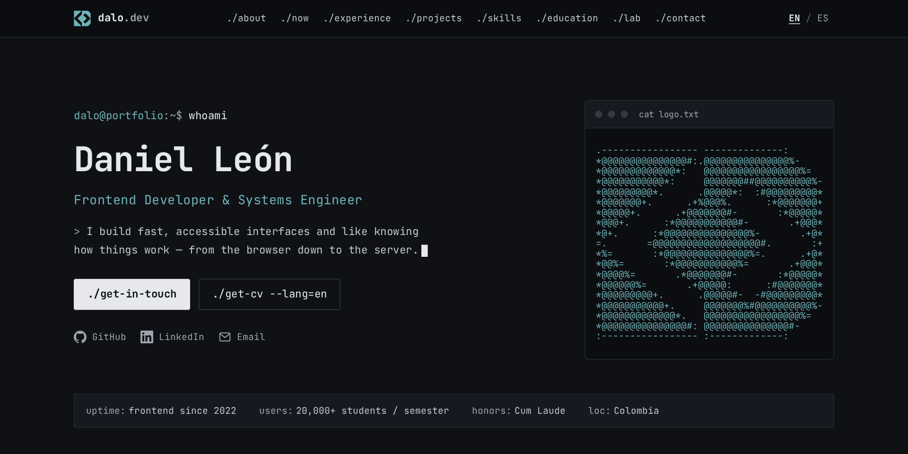

# dalo.dev — portfolio v2

[](https://github.com/dalo-dev/portfolio-v2/actions/workflows/ci.yml)


My personal portfolio: a terminal-styled, bilingual (EN/ES), fully static site built with
[Astro](https://astro.build). Live at **[dalo.dev](https://dalo.dev)**.

[](https://dalo.dev)

## Highlights

- **Terminal look, normal website.** Prompts, `cat`/`ls`/`fastfetch` output and an ASCII logo,
  but navigation is plain links and scrolling: no fake shell to learn.
- **Bilingual.** English at `/`, Spanish at `/es/`. Every entry exists in both languages and the
  build fails if a translation is missing.
- **Accessible.** Semantic landmarks, skip link, visible focus, 44px targets, works without JS.
  axe runs on every route in both languages in CI.
- **Fast.** Static HTML, one self-hosted variable font, responsive AVIF/WebP images, and the
  animation code is lazy-loaded after first paint.
- **Motion with an off switch.** Boot intro (once per session), scroll reveals, terminal
  page transitions and an ASCII decode/glitch. All of it respects `prefers-reduced-motion`, and
  the footer has a pause toggle that's remembered.
- **Hardened.** A strict Content-Security-Policy (with hashes of the inline scripts) and security
  headers are generated at build time into `dist/_headers`.

## Stack

| Concern   | Tools                                                                  |
| :-------- | :--------------------------------------------------------------------- |
| Framework | Astro 7 (static output, built-in i18n, content collections, Fonts API) |
| Styling   | Vanilla CSS with design tokens and scoped styles (no Tailwind)         |
| Animation | GSAP (ScrollTrigger, ScrambleText) and Astro View Transitions          |
| Icons     | [Simple Icons](https://simpleicons.org), inlined as SVG at build time  |
| OG images | Satori and sharp, one card per language                                |
| Quality   | TypeScript, ESLint (jsx-a11y strict), Prettier, `astro check`          |
| Tests     | Playwright, @axe-core/playwright, Lighthouse CI                        |

## Getting started

Requires Node ≥ 22.22 and [pnpm](https://pnpm.io).

```sh
pnpm install
pnpm dev        # http://localhost:4321
```

| Command           | Action                                                     |
| :---------------- | :--------------------------------------------------------- |
| `pnpm dev`        | Dev server at `localhost:4321`                             |
| `pnpm build`      | Production build to `./dist/` (also validates all content) |
| `pnpm preview`    | Serve the production build locally                         |
| `pnpm check`      | Type-check with `astro check`                              |
| `pnpm lint`       | ESLint, including accessibility rules                      |
| `pnpm format`     | Format with Prettier (`format:check` only checks)          |
| `pnpm test:e2e`   | Playwright smoke, motion, navigation, CSP and axe tests    |
| `pnpm test:a11y`  | Only the axe accessibility tests                           |
| `pnpm lighthouse` | Lighthouse CI on `/` and `/es/` (run `pnpm build` first)   |

The Playwright suite builds the site and serves it on port 4322, so it never reuses a running dev
server. CI runs every check above on each push and pull request.

## Editing content

Everything shown on the site lives in `src/content/` and is validated by the schemas in
`src/content.config.ts`. Localized entries exist once per language with the **same file name**.

| What                | Where                                                        |
| :------------------ | :----------------------------------------------------------- |
| Experience          | `src/content/experience/{en,es}/<slug>.yaml`                 |
| Education           | `src/content/education/{en,es}/<slug>.yaml`                  |
| Projects            | `src/content/projects/{en,es}/<slug>.yaml`                   |
| Now                 | `src/content/now/{en,es}/now.yaml`                           |
| The lab             | `src/content/lab/{en,es}/lab.yaml`                           |
| Skills              | `src/content/skills.yaml` (group labels in `src/i18n/ui.ts`) |
| UI strings          | `src/i18n/ui.ts`                                             |
| Links, languages    | `src/data/site.ts`                                           |
| CV                  | `public/cv/CV_EN.pdf`, `public/cv/CV_ES.pdf`                 |
| Photo               | `src/assets/images/me.jpg`                                   |
| Favicons, app icons | `public/favicons/`                                           |

Dates use `YYYY-MM`; `end: null` marks a current role. Skill icons use
[Simple Icons](https://simpleicons.org) slugs.

To add a project, for example, create `src/content/projects/en/my-project.yaml` and
`src/content/projects/es/my-project.yaml`. No code changes are needed.

## Project structure

```
src/
├── components/
│   ├── layout/      Header (with mobile menu), Footer, LanguageSwitcher
│   ├── motion/      Boot intro, motion state and pause toggle
│   ├── sections/    One component per home page section
│   ├── terminal/    Prompt, window chrome, cursor, ASCII logo
│   └── ui/          Cards, timeline, tags, social links
├── content/         YAML content per language (see above)
├── i18n/            UI dictionary and locale helpers
├── lib/             Content queries, icons, structured data
├── pages/           Thin routes for each language, 404s and OG images
├── scripts/anim/    Lazy-loaded GSAP animations
├── styles/          Design tokens and global styles
└── views/           Page markup shared by both languages
integrations/        Build step that writes the CSP and security headers
tests/               Playwright specs
```

## Design

Colors, type and spacing are tokens in `src/styles/tokens.css`: a graphite palette with a
single teal accent, every text color checked for WCAG AA contrast. Components only use the
semantic `--color-*` roles, never raw hex values. The typeface is
[JetBrains Mono](https://www.jetbrains.com/lp/mono/).

## Deployment

`pnpm build` outputs a static site in `dist/`, ready for any static host. The generated
`dist/_headers` file applies the security headers and long-lived caching for hashed assets on
hosts that read it, such as Cloudflare Pages and Netlify.
